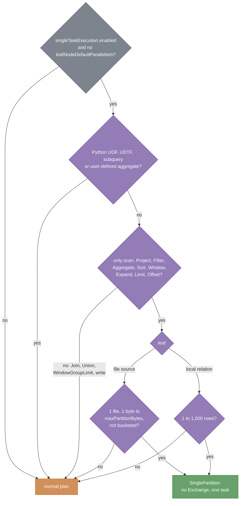

# Chapter 23: Project Feather: small queries without the distributed tax

Spark plans each query as if the data is large. A `groupBy` gets a partial aggregate, a shuffle and a final aggregate. An `orderBy` gets a second shuffle, with a sample job before it. Each shuffle is a stage boundary, and AQE submits each stage as a separate job. On a cluster with terabytes of data, this machinery costs a small part of the run time. On a 12 KB file, the machinery is almost all of the run time.

Project Feather ([SPARK-56978](https://issues.apache.org/jira/browse/SPARK-56978)) is a set of changes for this case: notebooks, test suites, agents and other workloads that send many small queries. Spark 4.3 includes its first two parts. Both are off by default. This chapter is about the main part, **single-task execution** ([SPARK-57851](https://issues.apache.org/jira/browse/SPARK-57851)), and it also measures the second part, an Arrow format for the cache.

**Single-task execution removes the shuffles from a query when the optimizer can prove that the input fits in one task. The rule that decides this is strict and short: one file or one small local relation, and only a fixed list of operators above it. Inside these limits, a small query runs as one job and one task, and the time per query decreases by a large fraction. Outside them, nothing changes. Near the upper size limit, one task is slower than many tasks, so the crossover point is a property of your data, and you must measure it.**

The scripts are in [`code/ch23`](https://github.com/lisancao/spark-masterclass/tree/main/code/ch23), and each output block comes from `code/ch23/output/`. All runs use Spark 4.3.0 in `local[*]` mode on 16 cores, with the session time zone set to UTC. Each timing is a median after warm-up runs, measured while no other benchmark ran on the machine. [Chapter 1](ch01-how-spark-runs.md) gave the first measurement of Feather. This chapter explains the rule, finds its limits, and shows its effect on plans, AQE, the Spark UI and Spark Connect.

## Step 1: Read the rule in the 4.3 source

Single-task execution has two parts. An optimizer rule marks a plan. Then the physical scan decides if the files are small enough.

The rule is `MarkSingleTaskExecution` in `sql/core/src/main/scala/org/apache/spark/sql/execution/datasources/`. `SparkOptimizer` runs it in a batch of its own, as the last batch of the optimizer. A comment in that file gives the reason: no later rule can change the shape of the plan or copy the marked scan nodes. The rule does these checks, in this sequence:

1. If `spark.sql.optimizer.singleTaskExecution.enabled` is `false`, or if `spark.sql.leafNodeDefaultParallelism` is set, stop. The second setting is an explicit request for a number of partitions, and the rule obeys it.
2. If the plan contains a pattern from the `unsupportedPatterns` list, stop. The list is: Python UDFs (`PYTHON_UDF`, `EVAL_PYTHON_UDF`), Python UDTFs, `EXISTS`, `IN` and scalar subqueries, lateral subqueries, table arguments of table functions, and user-defined aggregate functions.
3. Examine each node of the plan, from the root. Each node must be one of these:
    - a leaf: `LogicalRelation` (a file source) or `LocalRelation` (rows that the driver holds),
    - an operator that never adds a shuffle: `Project`, `Filter`, `DeserializeToObject`, `SerializeFromObject`,
    - an operator that adds a shuffle, if its internal setting is on: `Aggregate`, `Expand`, `GlobalLimit`, `LocalLimit`, `Offset`, `Sort`, `Window`.

    Any other node (a `Join`, a `Union`, a `WindowGroupLimit`, a write command) makes the plan ineligible.
4. If the shape passes, clone the plan and set a tag (`__single_task_execution`) on each leaf and on each `Expand`.

The planner then reads the tag. For a `LocalRelation`, `LocalTableScanExec` reports `SinglePartition` if the relation has between 1 and 1,000 rows. For a file source, `FileSourceScanExec.useSingleTaskExecution` does the final check:

```scala
numFiles >= minNumFiles && numFiles <= maxNumFiles &&
  numBytes >= minNumBytes && numBytes <= maxPartitionBytes
```

The defaults are one file (`minNumFiles` and `maxNumFiles` are both 1), at least one byte, and at most `spark.sql.files.maxPartitionBytes` (128 MB). Bucketed scans never qualify. If the check passes, the scan reports `SinglePartition` as its output partitioning. Then `EnsureRequirements`, the rule that adds an `Exchange` where an operator needs a different partitioning, finds that one partition already satisfies each requirement, and it adds no `Exchange`. The scan also coalesces its input to one partition, so the query stays correct when dynamic pruning changes the file list.



Five internal settings (`singleTaskExecution.aggregation`, `.expand`, `.limitOffset`, `.sort`, `.window`) turn off one operator each. They all fall back to the main setting. The file limits (`maxNumFiles`, `minNumFiles`, `minNumBytes`) and the row limits (`localTableScan.minRows`, `localTableScan.threshold`) are also internal settings. This chapter uses only the main setting.

## Step 2: Which queries qualify

`eligibility.py` runs each query shape two times, with the setting off and then on. For each run, it counts the `Exchange` nodes in the physical plan, and it reads the jobs and tasks of the run from the REST API of the Spark UI:

```python
def measure(build, enabled, label):
    spark.conf.set(FLAG, enabled)
    df = build()
    ...
        exchanges = plan(df, "simple").count("Exchange")
        spark.sparkContext.setJobDescription(label)
        df.collect()
```

<<ELIGTABLE>>

## Step 3: What single-task execution does to a plan

`plans_aqe.py` prints the plan of one query (the zones by borough, sorted) before and after `collect()`, with the setting off and on. The lines are cut at the scan options:

<<PLANS>>

## Step 4: What changes in AQE and in the Spark UI

<<AQEUI>>

## Step 5: The crossover across data sizes

<<CROSSOVER>>

## Step 6: The first query in a new session

<<COLD>>

## Step 7: Single-task execution over Spark Connect

<<CONNECT>>

## Step 8: The other part of Feather in 4.3: an Arrow cache

<<ARROWCACHE>>

## The whole chapter, on one page

<<RECAP>>
